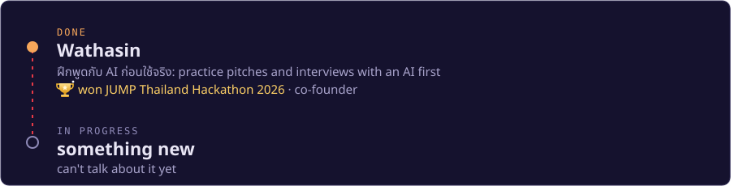

### 🌠 About me

Hey! I'm **Thanawat Thipkaew** — just call me **OWEN**. A Thai guy studying **Computer Engineering at PSU**, into **software, networks and AI agents**.

Every day new tools drop, and I like to grab them, actually use them, and turn what I learn into ideas for the next thing to build. Off the clock I'm gaming, reading manga, or (honestly) still at my computer.

### 🗺️ Quest log

### ⚔️ Inventory

  

### 📊 Battle record

  
  
   
  

  <picture>
    <source media="(prefers-color-scheme: dark)" srcset="https://raw.githubusercontent.com/Thanawat-ONZro/Thanawat-ONZro/output/snake-dark.svg"/>
    
  </picture>

